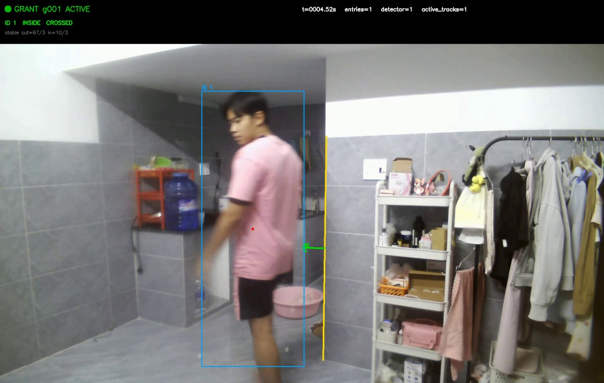
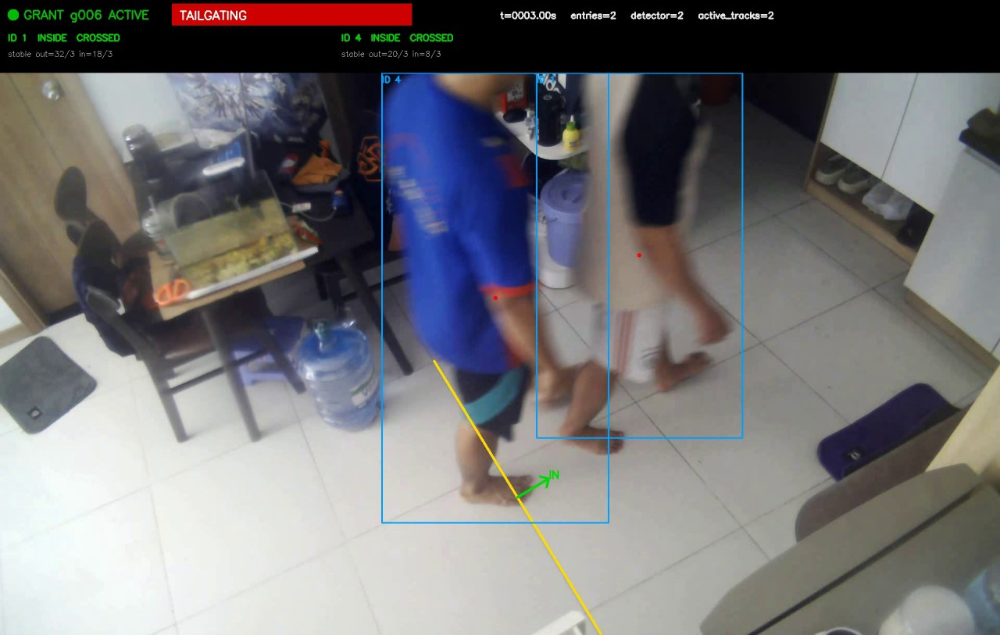
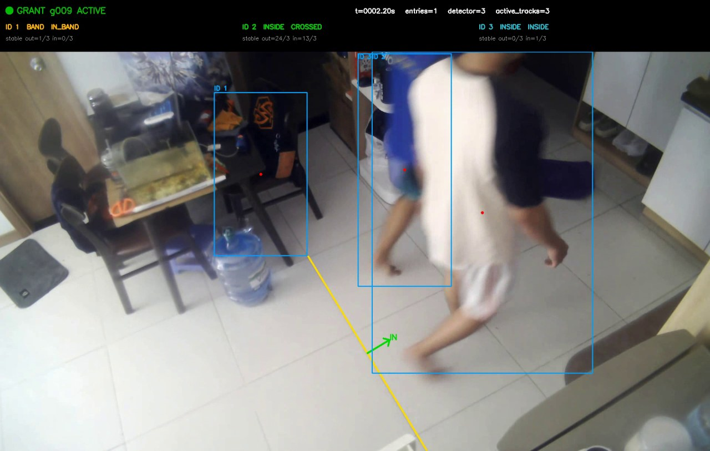

# Offline Tailgating Detection

An offline CPU pipeline that counts people crossing an access-controlled door,
associates entry crossings with access grants, and reports tailgating or
unauthorized-entry events.

## Quick start

```powershell
python -m venv .venv
.\.venv\Scripts\Activate.ps1
pip install -r requirements.txt
python configure_camera.py --video clips\door_01.mp4 --out configs\door_01.yaml
python detect_tailgating.py --video clips\door_01.mp4 --grants clips\door_01_grants.csv --gt clips\door_01_gt.csv --config configs\door_01.yaml --model models\yolox_nano.onnx --out results\door_01
```

The pipeline runs locally and does not use cloud inference. Place the fixed
`416 x 416` YOLOX-Nano ONNX model at `models/yolox_nano.onnx`.

Run every labeled clip recursively:

```powershell
python scripts\run_all.py --clips clips --configs configs --results results\submission_baseline_416 --model models\yolox_nano.onnx
```

## Measured results

The baseline benchmark processed all 41 labeled clips with annotated-video
rendering enabled.

| Metric | Result |
|---|---:|
| Clips | 41 |
| Frames | 9,594 |
| Access grants | 31 |
| Pipeline processing speed | 16.16 FPS |
| Tailgating precision | 0.600 |
| Tailgating recall | 0.750 |
| Tailgating F1 | 0.667 |
| Exact count accuracy | 0.806 (25/31) |
| Count MAE | 0.226 |
| Unauthorized-entry precision | 0.500 |
| Unauthorized-entry recall | 0.333 |
| Unauthorized-entry F1 | 0.400 |

Processing speed is total frames divided by summed pipeline time and excludes
process/model startup. The measured setup used ONNX Runtime 1.23.2 with the CPU
execution provider on Windows 11.

Committed benchmark artifacts:

- `benchmark/summary_baseline_030.json`
- `benchmark/metrics_by_clip_baseline_030.csv`
- `benchmark/metrics_by_session_baseline_030.csv`
- [`REPORT.md`](REPORT.md)

### Confidence-threshold ablation

| Confidence | Processing FPS | Tailgating F1 | Count accuracy | Count MAE | Unauthorized F1 |
|---:|---:|---:|---:|---:|---:|
| 0.30 | 16.16 | **0.667** | 0.806 | 0.226 | **0.400** |
| 0.45 | 14.24 | 0.600 | 0.806 | **0.194** | 0.000 |

The stricter threshold removes several background false detections and produces
a cleaner visualization, but it loses low-confidence people and worsens event
metrics. Therefore `0.30` remains the measured submission baseline. The 0.45
result is retained in `benchmark/summary_strict_045.json` as an ablation rather
than silently replacing the stronger baseline.

## Demo

### Normal entry — correct count

One person crosses during grant `g001`; the system reports `entries=1` with no
alert.



[Download the normal-entry annotated demo](demo_videos/normal_entry.mp4)

### Tailgating — correct alert

Two people cross during grant `g006`; the system reports `entries=2` and shows
the red `TAILGATING` banner. This visualization uses the stricter 0.45 ablation
to suppress an obvious background false box; the benchmark table above keeps
the 0.30 baseline metrics separate.



[Download the tailgating annotated demo](demo_videos/tailgating_correct_strict045.mp4)

### Failure example — overlapping people

Two people cross almost simultaneously, but the system reports only one entry.
This is a false negative caused by detector/track merging under overlap.



## Reproduce checks

```powershell
python -m pytest -q
python scripts\validate_dataset.py --clips clips
python scripts\summarize_results.py --results results\submission_baseline_416 --clips clips
```

Current automated verification: **41 tests passed** and all 41 clip companion
files validated without errors. Four effective grant-window overlaps are
reported as warnings and documented in the report.

## Dataset audit note

All current clip metadata files contain `scenario_id=1`. Overall and per-session
metrics are valid for the labels provided, but per-scenario coverage for
scenarios 2–10 must not be claimed until those metadata labels are corrected.

See [`DATASET.md`](DATASET.md), [`ASSUMPTIONS.md`](ASSUMPTIONS.md),
[`LICENSES.md`](LICENSES.md), and [`ALGORITHM.md`](ALGORITHM.md) for supporting
documentation.
